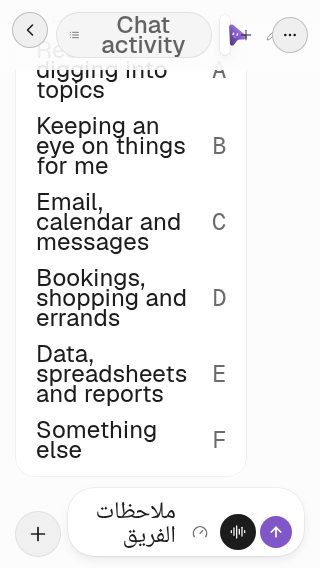
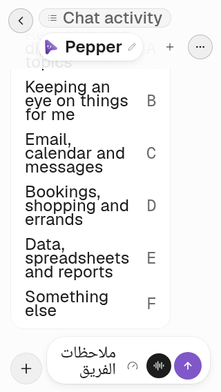

# Phone web app installation

The HTML links a standalone web manifest and existing-brand PNG icons. The
static server serves the manifest with `application/manifest+json`. Its start
address, scope and identity stay at the workspace root with no pairing tokens.
On iPhone and iPad, qualify the installed Home Screen app first. It keeps
WebKit's system viewport rather than drawing under the status bar. The app
respects reported safe-area insets without adding an extra spacer when WebKit
already reserves the space. Touch standalone windows keep an opaque chat header
in portrait, landscape and iPad Split View.
On touch WebKit Home Screen launches, a fixed edge supplies the skin color for
the system status bar without adding space or intercepting taps. This is a
[workaround for WebKit's native blur](https://zenn.dev/uakihir0/articles/260920-ios27-pwa-blur),
not a CSS switch for the system effect. Check a cold launch, scroll and resume
on an installed iPhone and iPad; a Safari tab is the negative control.

## Isolated browser checks

```sh
pnpm exec vitest run scripts/testing/web-app-assets.test.ts
pnpm exec vitest run server/index.test.ts -t 'serves packaged UI'
pnpm exec vite build
OMB_UI_E2E=1 pnpm exec vitest run scripts/testing/web-app-ui.e2e.test.ts
OMB_CDP_CHROME=/usr/bin/chromium OMB_UI_E2E=1 pnpm exec vitest run scripts/testing/touch-file-actions.e2e.test.ts
```

The UI recipe launches a disposable verification server with fake engines and
the production UI build. It owns a new Chrome profile and installs the pinned
test browser if necessary. It checks Chrome's parsed manifest and installability
errors, portrait and landscape safe areas, touch text that avoids automatic
focus zoom with an aligned mention mirror, a real composer send and reload
without duplicate messages, and the absence of a service worker or offline
cache. Screenshots and browser results are saved beside the fixture server log.
`OMB_WEB_APP_BUILD` can select an already-built UI directory. Neither the user's
browser profile nor live OpenMausBot data is used.

The Home Screen layout check records animation-frame geometry and touch events
in both modes. It switches between a quiet thread and one at 93% context, opens
Bots, Threads and More, resizes a draft, and invokes Compact now.
The typing check also replays a keyboard that shrinks and pans only the visible
viewport, then dismisses it. The header must stay visible, the composer must
stay next to the keyboard, and the draft must survive. The file
check opens, closes and saves a long-named upload, linked file and delivered
file. Both use the production renderer, not a live workspace or an iOS simulator.

These automated checks do not prove physical phone installation. Follow the
[phone installation guide](../phone-web-app.md) in a disposable workspace for
device qualification:

- iPhone and iPad Safari: Add to Home Screen, verify the icon and name, then
  launch without Safari's address bar. Check that the top of the chat controls
  and the first row of the open bot list are sharp and tappable, in portrait
  and landscape. On iPad repeat in full width and narrow Split View with
  Request Desktop Website enabled. Check Settings and the home indicator too.
  A Chromium layout check cannot verify the iOS compositor's fade.
- Android Chrome: Install app, launch from its icon and verify the same layout.
- Pair the installed window if needed; send a fixture message, quit and reopen,
  then confirm one stored message and its reply. Check that an unpaired or
  revoked window must pair again.
- Background and resume the app, then focus the composer with the software
  keyboard open. Confirm that the composer and Send remain reachable.
- Disconnect and reconnect to the running fixture server; verify the existing
  connection status and recovery rather than expecting offline chat.
- Remove only the test installation and disposable workspace afterward.

Record browser and OS versions and whether each check used a simulator or a
physical device. No real account, paid provider or production server is needed.

## Layout evidence

These production-renderer captures use a 390px Chrome viewport with synthetic
44px top and 34px bottom safe areas, and the same disposable fake-engine setup.
The before capture uses unchanged main's HTML and CSS. Neither is a physical
phone screenshot.

| Before: no explicit phone safe areas | After: controls inside the usable area |
| --- | --- |
|  |  |

## iOS simulator qualification

On 2026-10-11, the production build was tested in a newly created iPhone 17 Pro
simulator running iOS 26.5 (23F77), hosted on a physical Mac with macOS 26.6.2.
Safari's **Add to Home Screen** showed the OpenMausBot name and icon with **Open
as Web App** enabled. Launching that icon opened a standalone window without a
Safari address bar. The server and model were disposable loopback fixtures.

The onscreen keyboard was used to enter and send `Ios`. The real messages API
recorded one matching user message and a settled fake-engine reply. Keyboard
dismissal restored the header below the status bar; the composer stayed reachable
while typing. Landscape rotation and Home Screen background/resume preserved
the chat and kept its controls clear of the cutout and home indicator. Settings
opened with reachable controls in both orientations. Terminating the web app
and reopening its Home Screen icon preserved the chat, with one stored `Ios`
message and no duplicate send.

The keyboard check caught Safari's automatic zoom of the original 15px editor.
The touch editor and its mention mirror now use 16px; user zoom is still enabled.
A production-renderer regression test failed at 15px and passed after this fix.


This was a simulator, not a physical iPhone. Physical iPhone and Android
installation, remote HTTPS pairing/revocation and interrupted-network recovery
remain device-checklist items; none is claimed as performed here.

## Responsive fork qualification (L5)

**Scope:** laptop web and Chromium touch emulation on Linux, not physical Safari or the native phone app. The [L1 action inventory](responsive-workspace-actions.md) describes the fork at baseline; “supported” in that inventory means a source entry exists, not that every action was exercised here. This checklist records observed outcomes on the integrated renderer.

Reference: fork-main `7ce06af8f2f991b0003cb5d390f1cdb4a3cc0593`. Candidate: that revision plus [the renderer patch][patch], SHA-256 `8e01b7f5c007a46b6589c5e4a4bd30aff8a7f7735027c5dd45370d6782b11269`; **not a candidate commit**. Served `index.html` SHA-256 `d97f6bfb779be737390aee7fdd902eb95bd5425ad10e27b28e03e9a56f26789b`. The archive launcher rebuilt with the same lockfile; the probe compared the served HTML to the build. No untracked renderer source at capture. New profiles, disposable loopback workspaces, synthetic bots, messages and documents throughout.

The sorted `src/` manifests for the [worktree](../../.omb-scratch/verify-evidence/l5-displayed/worktree-src.sha256) and [reconstructed archive](../../.omb-scratch/verify-evidence/l5-displayed/archive-src.sha256) produced the same SHA-256: `d8b1d8bd9037be670cdffbf5c6d64af9e62aef26f52bf8c5df974e16bd8134e9` (links are digest receipts). Lockfile SHA-256: `ebf7a3ac8ebe8c37fcfd0d59cf2aa3ee840b263695d4e0ecf3f607ecf892092e`. The functional results below refer to the integrated HTML, not the earlier L3 or L4 work-in-progress builds.

**Decision:** the integrated browser candidate passed 36/36 displayed L1 performance comparisons and 3/3 comparable fork-detail pairs. The 320px header hit targets no longer overlap in the emulated fixture. **Not a release sign-off:** two failed historical measurements remain below, the cause of the original drawer tail is unresolved, physical iPhone/iPad testing is unavailable, and the owner has not approved the visual differences.

### Layout and action checklist

| Probe | Observed result |
| --- | --- |
| Window size | Both modes: 320×568, 390×844 and 844×390; 507px Split View approximation, 767/768/769px, 820×1180 and 1024×768; 1366×768 and 1440×900. Every size opened Inbox, read its list, closed it and retained the same Arabic draft. No page-wide horizontal overflow. |
| Text, theme, accessibility | Simple used Midnight; Advanced used Daylight with Chromium's actual 24px minimum font size. Both used reduced motion and verified computed RTL editor direction, visual Right-arrow caret movement, and accessibility-tree roles/names for the editor, Send and the narrow list opener. Opening Settings changed the theme in both directions. This is not a spoken screen-reader session or a mirrored app translation: the fork ships no RTL UI language pack. |
| Pane and list breakpoints | Crossed the 768px list transition both ways. With Inbox still open, the sidebar folded and returned across 1039/1040/1041px (Simple) and 1279/1280/1281px (Advanced). In the separate [two-client resize run][peer], the other client saw no shared selection change, a hidden reply stayed unread after widening, explicit open marked it read, and a deleted thread was not resurrected. [Narrow room][peer-narrow] · [restored grid][peer-wide]. |
| Profile and Computer | [Simple laptop, five checks](../../.omb-scratch/verify-evidence/l5-displayed/panel-boundaries/results.json). With Profile open, crossed 921→920→919→920→921: it overlaid the chat only at 919. With Computer also open, crossed 1537→1536→1535→1536→1537: Profile switched to overlay only at 1535. Closing both returned to the original RTL draft. [Two panels at 1537px](../../.omb-scratch/verify-evidence/l5-displayed/panel-boundaries/simple-laptop/profile-and-computer-1537.png) |
| Read, type, attach, send | [36/36 composer checks][compose]. One stored multiline send with attachment; streamed reply; a second attachment and draft survived file preview and return. Rotating preserved the code block's 100px internal scroll offset. Touch read/close did not focus an editor; laptop Tab/Shift+Tab and Enter worked. Phone controls fit the reduced viewport; iPad used trusted hardware-style key events, **not a physical keyboard**. [Short-height phone][short] · [iPad reading recording][reading]. |
| Other screens | Both modes on 1366/820/390: read the attached file, Computer panel, Inbox, Calendar and a noncurrent room thread; Deny resolved the matching waiting request. [54/54 eligible L4 action checks][actions]: message-specific bot/room forks and `/fork` verified by saved origin, origin chip back to original draft, touch command palette, touch reorder/rename/move/delete within rooms. Simple phone restored an archived bot; Advanced phone opened a local pinned page in-app and in a separate target. [Phone fork][fork]. |
| Host and permissions | The standalone host correctly lacked fleet Installations (six checks); phone was not treated as a tiled host (four checks). A separate signed Team fixture exercised the Advanced phone member's Team files preview and folder creation, absent delete control and server refusal for a teammate's file, and private-fork/reorder denials. Its UI uses the real components in a Vite preview, not the production archive. The first combined run stopped before that UI at owner config seeding (403); the [revised fixture and 17 other affected files passed 220/220][units], without relaxing authorization. |
| Electron shared renderer | Offscreen Linux Electron 43.8.3 / Chromium 150.0.7871.250 at 1366×768 opened two columns, closed the empty tile, and appended text to the same draft. [Screenshot after closing](../../.omb-scratch/verify-evidence/l5-integrated/electron-returned.png) · [run](../../.omb-scratch/verify-evidence/l5-integrated/electron-returned.log). This exercised the production renderer, **not** desktop preload or native bridge permissions. The separate legacy `--sidebar-attention-only` smoke timed out waiting for its 320px comfortable sidebar; that popover was not qualified by the pane smoke. |
| Physical devices | **iPhone Safari/Home Screen: unverified. iPad Safari/Home Screen: unverified.** No hardware was explicitly available for isolated fixture pairing; planning enumeration errored, which is not device proof. Native IME, accessory keyboard, cutouts, actual rotation/Split View, background/resume and reconnect need the device checklist above. The manifest and portrait/landscape inset checks here used Chromium; the earlier iOS simulator record is not a pass for this candidate. |

**Visual evidence:** [390px phone — multiline draft and attachment](assets/phone-web-app/l5-phone-draft.png) · [507px iPad Split View approximation — draft after Inbox](assets/phone-web-app/l5-ipad-split-return.png) · [1024px iPad — same draft after widening](../../.omb-scratch/verify-evidence/l5-integrated/stress/advanced-ipad/returned-8-1024.png) · [1366px laptop — file preview](assets/phone-web-app/l5-laptop-preview.png). These are synthetic workspace captures for the owner's review, not an owner decision.

**Independent cloud timeout:** the existing [`server/cloud-team.e2e.test.ts -t 'a signed-in member can fork'` run](../../.omb-scratch/verify-evidence/l4-fork-permissions.log) timed out before its first fork in the helper waiting for an idle bot, two messages and an engine dump. It did not establish a fork permission outcome. The [separate signed-member run][units] observed creation of the member's room fork (201), refusal after changing to View (403), refusal of another member's private fork (403/404), and refusal of member reorder (403). Not a retroactive pass for the timed-out test.

The [stress fixture][stress] completed **39/39** rows. Its 320px enlarged-text check found a real issue on [fork-main][stress-base]: the hit test at the center of **Open Pepper's profile** returned **New thread**; the center of **Rename Pepper** returned **More**. The integrated header wraps, and every visible header button owns its center point.

| Fork-main · 320×568, 24px minimum text | Integrated candidate · same conditions |
| --- | --- |
|  |  |

[patch]: ../../.omb-scratch/verify-evidence/l5-integrated/stress/renderer.patch
[stress]: ../../.omb-scratch/verify-evidence/l5-integrated/stress/results.json
[stress-base]: ../../.omb-scratch/verify-evidence/l5-integrated/stress-base/results.json
[peer]: ../../.omb-scratch/verify-evidence/l5-integrated/peer.log
[peer-narrow]: ../../.omb-scratch/verify-evidence/l5-integrated/peer-narrow.png
[peer-wide]: ../../.omb-scratch/verify-evidence/l5-integrated/peer-restored.png
[compose]: ../../.omb-scratch/verify-evidence/l5-integrated/composer/results.json
[short]: ../../.omb-scratch/verify-evidence/l5-integrated/composer/simple-phone/multiline-attachment.png
[reading]: ../../.omb-scratch/verify-evidence/l5-integrated/composer/advanced-ipad/reading.webm
[actions]: ../../.omb-scratch/verify-evidence/l5-integrated/actions/results.json
[fork]: ../../.omb-scratch/verify-evidence/l5-integrated/actions/advanced-phone/bot-fork-detail.png
[units]: ../../.omb-scratch/verify-evidence/l5-integrated/unit-final.log
[team]: ../../.omb-scratch/verify-evidence/l5-displayed/signed-team-files.log

### Displayed-viewport compositor latency

**All 36 comparable L1 cells passed the joint budget** with a **1600×1400 native Chromium window on both builds**. Each cell below is fork-main → integrated p95 in milliseconds (rounded); each side had 20 resolved input-to-compositor presentations. The rule rejects only when the candidate is **both** more than 20% and more than 17 ms slower. For example, Simple laptop stream rose 23.304→38.028 ms (+14.724 ms); Simple iPad Computer rose 305.650→323.711 ms (+5.9%). Neither crossed both thresholds.

| Mode / emulated window | Sidebar | Resize | Stream input | Computer | File | Inbox |
| --- | ---: | ---: | ---: | ---: | ---: | ---: |
| Simple laptop | 243→239 | 287→282 | 23→38 | 271→271 | 273→273 | 273→273 |
| Simple iPad | 241→227 | 292→281 | 20→20 | 306→324 | 77→76 | 336→336 |
| Simple phone | 272→273 | 250→262 | 16→17 | 305→304 | 73→72 | 273→271 |
| Advanced laptop | 238→240 | 270→261 | 30→27 | 271→271 | 272→272 | 273→273 |
| Advanced iPad | 233→237 | 260→267 | 17→18 | 302→303 | 74→74 | 364→305 |
| Advanced phone | 269→270 | 248→262 | 17→16 | 302→302 | 70→69 | 270→270 |

Native window size is not the emulated CSS viewport: phone remained 390×844, iPad 820×1180 and laptop 1366×768 for these trials. Same Chromium 155.0.8059.84, Linux Ryzen 7 8845HS, Daylight, fixture data and warmed production assets. The first four columns reuse the fully displayed [fork-main](../../.omb-scratch/verify-evidence/responsive-l3-displayed/fork-main/results.json) and [integrated](../../.omb-scratch/verify-evidence/l5-integrated/displayed-stream/results.json) captures, including warmup navigation. File and Inbox use fresh [fork-main](../../.omb-scratch/verify-evidence/l5-displayed/file-inbox-fork-main/results.json) and [integrated](../../.omb-scratch/verify-evidence/l5-displayed/file-inbox-integrated/results.json) runs with the same presented-frame matcher. No substitution of callback timings or removal of tail samples.

**Fork detail, separate from the 36 L1 cells:** all six candidate layouts opened the correct fork and returned to the original draft. The three available baseline pairs passed. A missing or inaccessible entry has no zero-millisecond baseline.

| Mode | Laptop, p95 ms | iPad, p95 ms | Phone, p95 ms |
| --- | ---: | ---: | ---: |
| Simple | 273.870→274.614 | 326.059→324.576 | absent→72.407 |
| Advanced | clipped→271.582 | 304.198→304.587 | absent→70.381 |

On Simple iPad, the [first fork-main run](../../.omb-scratch/verify-evidence/l5-displayed/actions-fork-main/results.json) did not close the open panel during warmup; **zero timed opens**, not a passing baseline. The [candidate](../../.omb-scratch/verify-evidence/l5-displayed/actions-integrated/results.json) completed that run at 323.029 ms. The comparison above waits for the panel animation to settle before the **untimed warmup close on both sides**: [reference](../../.omb-scratch/verify-evidence/l5-displayed/fork-warmup-fork-main/results.json) · [candidate](../../.omb-scratch/verify-evidence/l5-displayed/fork-warmup-integrated/results.json). The 20 timed opens, frame matcher and budget are unchanged. [All exact comparisons, including the incomplete first pair](../../.omb-scratch/verify-evidence/l5-displayed/comparison.json).

### Historical measurements: smaller native compositor window

**Original run: two of 36 L1 p95 comparisons failed.** Simple phone list opening rose **270.398 → 371.649 ms** (+37.4%, +101.251 ms); trials 7 and 8 took 371.649 and 427.958 ms. Advanced phone input while streaming rose **72.090 → 115.345 ms** (+60.0%, +43.255 ms). Both exceeded 20% **and** 17 ms. All 88 eligible functional rows completed; ten other rows were explicitly host-only or inapplicable. A successful probe process is not a passing performance comparison.

Fork-main → candidate p95, ms, rounded. Same Chromium 155.0.8059.84, Ryzen 7 8845HS Linux x64 host, Node v26.13.1, Daylight fixture, warmed production assets, 20 input-to-compositor-presentation samples per action. All 720 candidate presentations resolved. Use the [exact L1 samples](../../.omb-scratch/verify-evidence/responsive-fork-main/results.json) and [candidate traces and samples](../../.omb-scratch/verify-evidence/l5-integrated/baseline-final/results.json), not rAF callback times.

| Mode / window | Sidebar | Resize | Stream input | Computer | File | Inbox |
| --- | ---: | ---: | ---: | ---: | ---: | ---: |
| Simple laptop | 244→246 | 297→318 | 41→19 | 270→270 | 272→271 | 272→271 |
| Simple iPad | 239→225 | 318→316 | 18→21 | 306→319 | 74→74 | 334→335 |
| Simple phone | **270→372** | 250→263 | 184→191 | 303→303 | 71→71 | 271→271 |
| Advanced laptop | 241→233 | 266→264 | 31→25 | 270→269 | 270→271 | 271→270 |
| Advanced iPad | 237→237 | 266→261 | 17→17 | 303→318 | 73→72 | 304→303 |
| Advanced phone | 269→270 | 248→263 | **72→115** | 302→302 | 70→69 | 269→269 |

The [displayed-editor control](../../.omb-scratch/verify-evidence/responsive-l3-displayed/report.md) found that Chromium's default 780×580 native headless window clipped the emulated phone editor. A plain native textarea reproduced the dependence on whether its caret was on the compositor surface. On the integrated build, the displayed Advanced phone stream measured **16.907 → 16.144 ms**. Independently, a [counterbalanced Simple phone drawer comparison](../../.omb-scratch/verify-evidence/drawer-paired/report.md) measured **270.313 → 270.351 ms**. The original two slow drawer traces contain both additional CPU time and time off CPU; their cause is unresolved. Neither repeat erases the failed observations.

Under the original native-window protocol, fork-origin detail open, 20 presented opens per cell: Simple laptop 357.571→357.039 ms and iPad 331.571→321.674 ms; Advanced iPad 316.967→304.778 ms. Advanced laptop's original entry was clipped and phone's was absent: their candidate p95s (337.493, 74.679 Simple phone, 70.123 Advanced phone) have **no comparable baseline**. [Original panel references](../../.omb-scratch/verify-evidence/responsive-l4-report.md) · [candidate origins][actions].

No blanket parity sign-off: inventory-only workflows were not all run on every eligible host, hardware is unverified, and the owner's visual review is outstanding. Do not advertise native bridges, fleet operations, or the earlier iOS simulator run as phone-web coverage.

### Disposition of the 28 formerly missing or unresolved actions

The [432-row fork-main inventory](responsive-workspace-actions.md) is historical. These are candidate results for its 28 Missing/Unresolved rows, not 432 device-tested workflows. “Phone” and “iPad” below mean Chromium touch emulation.

| Historical action | Candidate result and evidence |
| --- | --- |
| Open the command palette | Both modes on laptop, iPad and phone: ran the theme command from the account menu. [Actions][actions] |
| Install phone web app | **Unverified on hardware.** A Chromium manifest or inset check is not Safari Share → Add to Home Screen → launch. [Device checklist](#phone-web-app-installation) |
| Restore archived bot | Simple phone: restored an archived fixture bot and read back its state. [Actions][actions] |
| Set a bot’s main thread | **Not a conversation menu action on any client.** Selecting a conversation does not change the bot's routing destination. [Inventory](responsive-workspace-actions.md#thr) |
| Fork latest text turn | Both modes, all three layouts: `/fork` created a new thread at the latest completed text; no literal command was sent. [Actions][actions] |
| Fork at a particular message | Both modes, all three layouts: selected bot and room message IDs matched the stored fork origins. [Actions][actions] |
| Follow fork from its origin | Both modes, all three layouts: opened the named fork from its chip, then returned to the original draft. [Actions][actions] |
| Keep another viewer’s room selection unchanged on resize | Second client retained its selection and unread reply through the first client's resize. [Peer run][peer] |
| Return to open room detail after resize | Crossing 768 preserved the local room thread and return path; widening restored the grid. A deleted thread stayed deleted. [Peer run][peer] |
| Rename room | Both touch layouts and modes: persisted new name. [Room actions][actions] |
| Set room description | Both touch layouts and modes: persisted new description. [Room actions][actions] |
| Move room to department | Both touch layouts and modes: verified new section. [Room actions][actions] |
| Delete room | Both touch layouts and modes: confirmed removal of the fixture room. [Room actions][actions] |
| Reorder rooms within one list | Both touch layouts and modes: reordered two rooms in the same list. Non-admin reorder refused (403). [Room actions][actions] · [Signed member][units] |
| Open Team files | Signed Advanced phone member: Tools opened the team directory. Standalone host correctly omitted the entry. [Signed member][units] |
| Browse team folder | Entered the empty `Work` folder; the current breadcrumb and listing changed. Returned to root and found both original entries. [Signed phone][team] |
| Upload team file | Used Upload and the browser file input; `packing.txt` appeared inside `Work`. Only a synthetic fixture file was supplied, not an iOS picker. [Signed phone][team] |
| Create team folder | Signed Advanced phone member: created `Work`; server listing marked it theirs and deletable. [Signed member][units] |
| Preview team file | Signed Advanced phone member: opened a teammate's synthetic note and read its exact text. [Signed member][units] |
| Download team file | Downloaded `labels.txt` to a disposable browser download directory; its bytes matched the original file. [Signed phone][team] |
| Rename team entry | Creator renamed `packing.txt` to `labels.txt`; the old entry disappeared and the renamed file downloaded. [Signed phone][team] |
| Delete team entry | Creator accepted the confirmation for `labels.txt`; the UI and server listing became empty. A teammate's file had no delete control and server deletion returned 403. [Signed phone][team] |
| Control server-attached phone | **Unverified hardware dependency.** No isolated server-attached phone/controller; input into the client emulator is not this action. [Inventory](responsive-workspace-actions.md#pc) |
| Open browser picture-in-picture | **Unverified browser/backend capability.** No supported PiP session exercised; not an observed UI failure. [Inventory](responsive-workspace-actions.md#browser) |
| Import browser cookies | **Unverified importer dependency.** No compatible disposable importer qualified; no user cookies accessed. [Inventory](responsive-workspace-actions.md#browser) |
| Complete requested sign-in | **Unverified provider dependency.** No authorized test provider/account flow; no credentials used. [Inventory](responsive-workspace-actions.md#ask) |
| Open pinned web page | Advanced phone: configured loopback page rendered in panel. [Actions][actions] |
| Open panel URL outside Maus | Advanced phone: opened the same fixture URL in a separate browser target. [Actions][actions] |

### Reproduce locally

Run the traces one at a time. Pick a new `out`; each launcher refuses to overwrite a run. `--working-renderer` applies tracked `src/` changes to the archive: untracked renderer files must not be silently omitted.

```sh
rev=7ce06af8f2f991b0003cb5d390f1cdb4a3cc0593
out="$PWD/.omb-scratch/verify-evidence/my-l5"
export OMB_CDP_CHROME=/usr/bin/chromium
test -z "$(git ls-files --others --exclude-standard -- src)" || exit 1
bash scripts/testing/responsive-workspace-baseline.sh "$rev" "$out/baseline" --working-renderer
bash scripts/testing/responsive-workspace-baseline.sh "$rev" "$out/stress" --working-renderer '' '' qualification
bash scripts/testing/responsive-workspace-baseline.sh "$rev" "$out/actions" --working-renderer '' '' actions
bash scripts/testing/responsive-composer.sh "$rev" "$out/composer" --working-renderer '' '' composer
for build in fork-main integrated; do
  flag=''
  if [ "$build" = integrated ]; then flag=--working-renderer; fi
  for probe in stream file-inbox actions; do
    bash scripts/testing/responsive-composer.sh "$rev" "$out/$probe-$build" "$flag" '' '' "$probe"
  done
done
bash scripts/testing/responsive-composer.sh "$rev" "$out/panel-boundaries" --working-renderer simple laptop qualification
OMB_UI_E2E=1 ./node_modules/.bin/vitest run scripts/testing/responsive-team-files.e2e.test.ts
node --experimental-strip-types scripts/verify-threads.ts --check-pane-resize
./node_modules/.bin/vite build --outDir "$out/electron-dist"
node --experimental-strip-types scripts/testing/responsive-electron-smoke.mjs \
  /usr/lib/electron43/electron "$out/electron-dist" "$out/electron-returned.png"
```

The [exact Vitest invocation](../../.omb-scratch/verify-evidence/l5-integrated/unit-command.txt) includes navigation, composer, panel, permission and signed Team files checks. To reproduce the 320px before image, use `"$out/stress-base" '' advanced phone qualification` after the revision in the baseline command; the fork-main header hit test is **expected to fail**.
